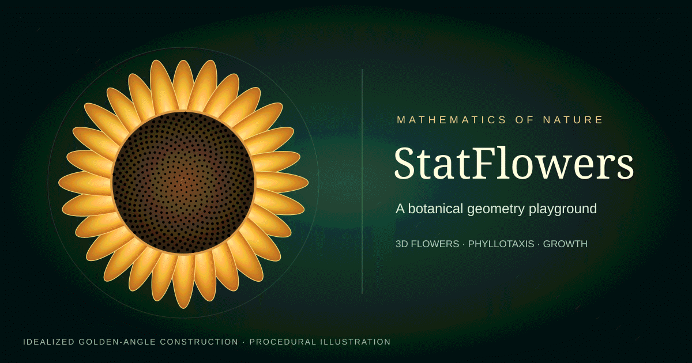

# Formogenesis

*Exploring how simple rules create complex forms and behaviours.*

Formogenesis is an open collection of interactive experiments in natural pattern formation, mathematical geometry and growth. The first experiment, **Flowers**, explores 3D botanical shapes, bloom animations and phyllotaxis. Future experiments may explore mushrooms, fingerprints, collective behaviour and other emergent systems. The visual models are experimental, with their scientific limitations documented alongside them.

*Illustrative procedural preview of sunflower phyllotaxis. The [Flowers experiment](https://statsilk.github.io/Formogenesis/) contains the interactive 3D models.*

## Run the app

[**Explore Flowers**](https://statsilk.github.io/Formogenesis/) · [**Compare petal methods**](https://statsilk.github.io/Formogenesis/petal-lab.html).

The site runs directly in your browser. `index.html` is the interface, `app.js` contains the flower geometry and controls, and Three.js is loaded from a CDN. An internet connection is required.

## First public preview

See the [v0.1.0 release notes](RELEASE_NOTES_v0.1.0.md). This is an experimental preview; botanical realism is still being refined.

## Source layout — Flowers experiment

The existing flower application stays at the repository root for now to preserve published URLs. Each future experiment can remain independently versioned and published, with a shared Formogenesis index connecting them. Reusable visualization and math code can be extracted into shared packages when it is actually shared by more than one experiment.

- `index.html`: interactive 3D studio interface and responsive layout
- `app.js`: procedural flower meshes, growth stages, 3D renderer and interactions
- `petal-lab.html`: orange reference / green growth-metric and bilayer comparison, plus curvature heatmaps
- `growth-metric.js`: reduced-order growth metric, candidate-mode fitting and equal-layer bilayer bending
- `PETAL_CURVATURE_METHODS.md`: discrete curvature mathematics and scientific limitations
- `DIFFERENTIAL_GROWTH_EXPERIMENT.md`: growth metric, numerical model, bilayer derivation, limitations and references
- `assets/social-preview.png`: reproducible procedural preview; source in `scripts/generate-social-preview.mjs`
- `CHANGELOG.md`: development history and model limitations

## Features

- Eight flower families including sunflower, rose, tulip, lily, daisy, gerbera, coneflower, poppy
- Several rose styles, inspired by natural and geometric forms
- 3D and top-down views, soft shadows, petal controls and colors
- Bud-to-bloom timeline and growth animation
- Golden-angle/Fibonacci phyllotaxis experiments for composite flower heads
- Side-by-side petal geometry laboratory comparing procedural and growth-metric-fitted surfaces, idealized bilayer bending, and curvature estimators

## Scientific accuracy

**Experimental model:** Flower forms and bloom animations are illustrative approximations, not mathematically exact reconstructions or predictive plant biology. The golden-angle model represents idealized phyllotaxis; real flowers differ substantially in development. The experimental growth-metric model fits a limited family of candidate shapes to prescribed in-plane lengths, and uses an idealized equal-layer bilayer formula for curling; it is not a validated shell or tissue-growth solver. See [method and limitations](DIFFERENTIAL_GROWTH_EXPERIMENT.md).

For composite heads, the floret arrangement follows an idealized Vogel-type radial construction, based on the golden angle. This geometric model is distinct from a developmental or mechanical simulation. See:

- Vogel, H. (1979). A better way to construct the sunflower head. *Mathematical Biosciences*, 44(3–4), 179–189. https://doi.org/10.1016/0025-5564(79)90080-4
- Douady, S., & Couder, Y. (1992). Phyllotaxis as a physical self-organized growth process. *Physical Review Letters*, 68(13), 2098–2101. https://doi.org/10.1103/PhysRevLett.68.2098
- Liang, H., & Mahadevan, L. (2011). Growth, geometry, and mechanics of a blooming lily. *PNAS*, 108(14), 5516–5521. https://doi.org/10.1073/pnas.1007808108 (Background for growth mechanics, not implemented here.)

## Origins

Independently implemented for this project. Inspired by botanical geometry approaches such as [Floraison](https://github.com/Wally869/Floraison); this project is **not a fork** and does not include Floraison source code.

## Changes and development status

See [CHANGELOG.md](CHANGELOG.md) for updates, experimental limitations and release history. The rose-growth model currently follows illustrative development stages, not a validated cellular-growth simulation.

## License

Released under the permissive [MIT License](LICENSE). You may use, modify and redistribute the code, including commercially, provided the copyright and license notices are retained.

### Third-party software

[Three.js](https://threejs.org/) is loaded from a CDN for 3D rendering and is distributed under the [MIT License](https://github.com/mrdoob/three.js/blob/master/LICENSE). The project's custom flower and petal geometry code is implemented separately.
